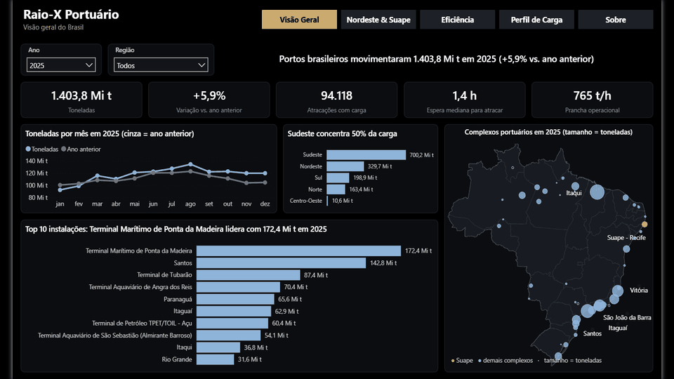
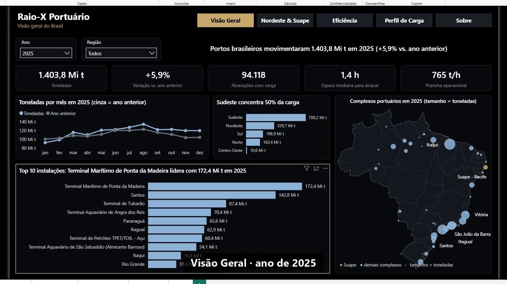
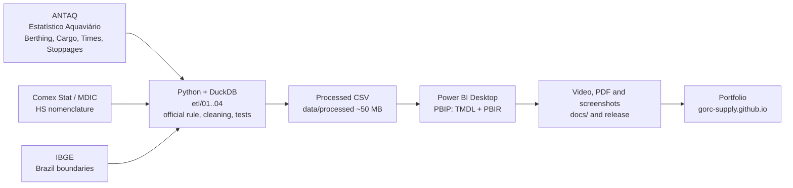
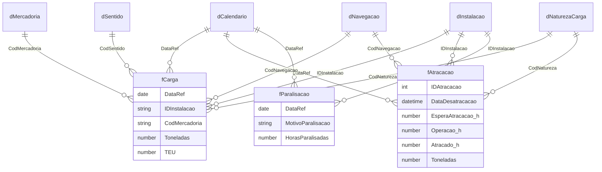

**English** · [Português](README.pt-BR.md)

# Raio-X Portuário: performance of Brazilian ports with a focus on the Northeast

How much Brazil moves, where ships wait and how Suape compares with its neighbors, built on ANTAQ open data, a pipeline that reproduces the official total and a Power BI dashboard.

Read the data story: [Brazil's ports hit a record. Suape grew in value, not in weight.](https://gorc-supply.github.io/stories/ports.html)



## How to view the dashboard

The dashboard is distributed as a video, a PDF, page screenshots and the PBIP file, which opens in Power BI Desktop (free).

- **Video (78 s):** [](docs/video/raio-x-portuario.mp4) — click the image to open the video.
- **PDF with the 5 pages:** [docs/RaioXPortuario.pdf](docs/RaioXPortuario.pdf)
- **Screenshots:** [Visão Geral (Overview)](docs/img/pagina-1.png) · [Nordeste & Suape (Northeast & Suape)](docs/img/pagina-2.png) · [Eficiência e Gargalos (Efficiency and Bottlenecks)](docs/img/pagina-3.png) · [Perfil de Carga (Cargo Profile)](docs/img/pagina-4.png) · [Sobre (About)](docs/img/pagina-5.png)
- **Interactive on your computer** (Power BI Desktop is free):
  1. Install [Power BI Desktop](https://www.microsoft.com/store/productId/9NTXR16HNW1T) (Microsoft Store).
  2. Download the zip from the [latest release](https://github.com/gorc-supply/raio-x-portuario/releases/latest) and extract it to `C:\projetos\raio-x-portuario\` (or clone the repository into that folder).
  3. Open `powerbi\RaioXPortuario.pbip`. If you extracted it somewhere else: **Home > Transform data > Edit parameters > CaminhoDados** and point it to the `data\processed\` folder (ending with `\`).
  4. Click **Refresh** (Home). The processed data is already in the zip; you don't need to run the Python code.

## The problem

ANTAQ's Estatístico Aquaviário (Waterway Statistics) has everything (every berthing, every cargo, every stoppage), but in files with millions of rows and counting rules that are not obvious. This project turns that data into a dashboard that answers four questions:

1. **How much does Brazil move** by port, region, type of navigation and cargo type, and how has that changed month by month and year by year?
2. **How does Suape compare** with Pecém, Itaqui, Salvador, Aratu, Recife, Natal, Cabedelo and Maceió in volume, growth and efficiency?
3. **Where are the bottlenecks:** wait to berth, time at berth vs operating time, handling rate, seasonality and stoppages?
4. **What does each port move:** main commodities, loading vs unloading, navigation profile?

Scope: full years 2021 to 2025.

## Key findings

All numbers come from [docs/valores_referencia.md](docs/valores_referencia.md) (section 4), with the source measure and filter.

1. **National record in 2025.** Brazilian ports moved **1,403.8 million t**, up **5.9%** on 2024. *Source: [Toneladas] (tonnes) and [Var % Toneladas AA] (year-over-year change), Ano = 2025.*
2. **Suape traded volume for value.** Tonnage stayed flat (**24.3 million t** in 2025, **-2.3%**, the country's **13th** largest facility, with **1.7%** of the total), but containers went from **519 thousand TEU** in 2021 to **698 thousand TEU** in 2025 (**34.6%** more), and the container share rose from **26.7%** to **31.2%**. *Source: [Toneladas], [Ranking Suape Brasil] (Suape's national rank), [% do Total Brasil] (share of Brazil's total), [TEU], [% Contêiner] (container share); Instalação = Suape.*
3. **Suape waits little to berth, but more than it used to.** The median wait was **4.3 h** in 2025, **22.1 h** below the peer average (**26.4 h**), an average pulled up by Itaqui, with a median wait of **143.9 h**. In 2021 Suape's median wait was **1.0 h**; in 2024 it reached **5.9 h**. *Source: [Espera Mediana (h)] (median wait), [Espera Mediana Média Pares (h)] (peer average of median waits), [Diferença Espera Suape vs Pares (h)] (Suape vs peers wait gap).*
4. **The cargo mix explains Suape's wait.** In 2025, container ships berthed with a median wait of **0.8 h**; liquid bulk ships (oil products, crude oil, LPG), **28.8 h**. Anyone who wants to improve Suape's queue has to look at the liquids berths. *Source: [Espera Mediana (h)], Instalação = Suape, Natureza = Contêiner / Granel Líquido e Gasoso.*
5. **Rain is the biggest time thief.** In Brazil, rain and weather account for **32.1%** of the hours stopped in 2025; in Suape, **37.9%**. Suape's operating handling rate (**618 t/h**) is below the national average (**765 t/h**), which is pulled up by the iron ore terminals. *Source: [Horas Paralisadas] (hours stopped) by reason; [Prancha Média Operacional (t/h)] (average operating handling rate).*

> **Note on 5.9% vs 6.1%.** ANTAQ's yearbook "Desempenho Aquaviário 2025" reports 6.1% growth in 2025. The dashboard's 2025 total matches the yearbook's (+0.05%), but the dashboard's 2024 base is 0.26% above the published one (ANTAQ revises the base after closing the yearbook), which lowers the change by 0.2 points. The dashboard number was not adjusted. Full calculation in [docs/conciliacao_antaq.md](docs/conciliacao_antaq.md#2-por-que-o-painel-mostra-59-em-2025-e-o-anuário-61).

## Architecture



## Data model (star schema)



One-to-many relationships with single-direction filtering, no many-to-many. Import mode. The `_Medidas` table holds the measures in folders (Volume, Participação, Eficiência, Auxiliares). Visible names are in Portuguese with accents (Região, Instalação, Navegação, Natureza da Carga, Mês...).

## KPI dictionary (summary)

| Measure | What it is |
|---|---|
| [Toneladas] (tonnes) | Gross weight moved (ANTAQ rule: `FlagMCOperacaoCarga = 1`, includes transshipment) |
| [Var % Toneladas AA] (year-over-year change) | Change against the same period of the previous year |
| [Nº Atracações] (number of berthings) | Berthings with cargo handling |
| [Espera Mediana (h)] (median wait) | Median hours between arrival and berthing — the typical ship |
| [% Atracado em Operação] (% of berth time operating) | Hours operating ÷ hours at berth |
| [Prancha Média Operacional (t/h)] (average operating handling rate) | Tonnes ÷ operating hours (ratio of sums) |
| [Ranking Porto] (port rank) | Position by tonnes among the visible ports |

All measures, with DAX, operational meaning and a numeric example: [docs/kpis.md](docs/kpis.md).

## Data quality

- **Reconciliation with ANTAQ** ([docs/conciliacao_antaq.md](docs/conciliacao_antaq.md)): pipeline annual total vs official total — gap between −0.13% and +1.16% from 2021 to 2025 (criterion: ±2%, tested in pytest). For 2025, an extra check against the yearbook (cargo type and regions) and the quarterly bulletins (Brazil, Suape, Itaqui and Pecém).
- **Cleaning rules and rows affected per year** ([docs/data_quality.md](docs/data_quality.md)).
- **Data exploration** ([docs/exploracao.md](docs/exploracao.md)): actual columns, keys, nulls, each time definition checked against the dates.
- **Decisions** ([docs/DECISOES.md](docs/DECISOES.md)): what was decided, the alternatives and why.

> **About the source.** ANTAQ's download portal (`web3.antaq.gov.br`) has been down since June 2026. The official files were taken from a public mirror (Hugging Face, CC-BY-4.0, pinned version) with the original layout; fidelity was checked against the official totals. When ANTAQ is back, the pipeline uses the official zips automatically. Details in [DECISOES.md, D02](docs/DECISOES.md).

## How to reproduce from scratch

Prerequisites: Windows, Git, Python 3.12 (or [uv](https://docs.astral.sh/uv/)) and Power BI Desktop.

```powershell
git clone https://github.com/gorc-supply/raio-x-portuario.git C:\projetos\raio-x-portuario
cd C:\projetos\raio-x-portuario
uv venv .venv --python 3.12          # or: py -3.12 -m venv .venv
uv pip install --python .venv\Scripts\python.exe -r requirements.txt
.venv\Scripts\python etl\run_all.py  # downloads, processes, exports, documents, validates the PBIP and runs the tests
```

1. `run_all.py` takes ~3 minutes and downloads ~90 MB into `data/raw/` (ignored by Git). The final CSV files go to `data/processed/`.
2. If you have ANTAQ's official zips, put them in `data/raw/antaq_oficial/` before running: they take priority over the mirror.
3. Open `powerbi/RaioXPortuario.pbip` in Power BI Desktop and click **Refresh**.
4. Check the cards against [docs/valores_referencia.md](docs/valores_referencia.md).

The report is generated by code (`etl/gerar_pbip.py`) and was reviewed in Desktop with automated screenshots (`ferramentas/`, screenshots in `docs/img/qa/`).

```text
etl/            01_download · 02_transform · 03_export · 04_documentar · explorar · kpis_doc · mapa_base
                gerar_pbip (generates the PBIP) · validar_pbip (PBIR schemas + references) · run_all
ferramentas/    Power BI Desktop automation for visual QA, video recording and deliverables (cover, GIF, PDF)
data/processed/ final CSV files (fCarga, fAtracacao/ per year, fParalisacao, dimensions, meta)
powerbi/        RaioXPortuario.pbip, .SemanticModel (TMDL), .Report (PBIR), tema-raio-x.json
docs/           decisions, open items, exploration, quality, reconciliation, KPIs, script, post, video, PDF
tests/          pytest: keys, orphans, negative hours, ±2% reconciliation, PBIP, README numbers
```

## Limitations

- **Full years only (2021–2025).** The mirror also includes January 2026, left out because the year is incomplete.
- **Fallback source.** The data was not downloaded from ANTAQ's website but from a public mirror of the same files. Reconciling with the official totals reduces this risk but does not remove it.
- **Commodities.** ANTAQ's official commodity table was not available; descriptions come from the official HS nomenclature (Comex Stat).
- **Map by port complex.** Suape appears in the official "Suape - Recife" complex; each complex's coordinate is the tonnage-weighted average of its facilities.
- **Breakdowns by navigation type** differ a bit more than the total (e.g., inland +8% in 2021) because of ANTAQ classification differences; the total matches.
- **Aggregated median wait is sensitive to the cargo mix** (see finding 4).

## Author and license

**Gabriel Cunha** — Supply Chain & Operations, Recife/PE · [LinkedIn](https://www.linkedin.com/in/gabriel-cunha-xp) · [GitHub](https://github.com/gorc-supply) · [Portfolio](https://gorc-supply.github.io)

Code under the [MIT](LICENSE) license. Data: ANTAQ (open data), via the mirror [vinicius-souza/antaq](https://huggingface.co/datasets/vinicius-souza/antaq) (CC-BY-4.0); HS nomenclature: Comex Stat/MDIC; boundaries: IBGE.
