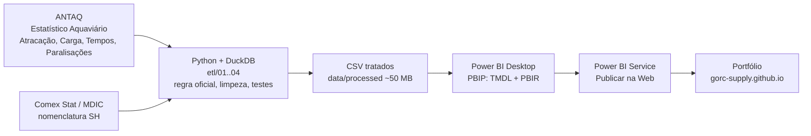
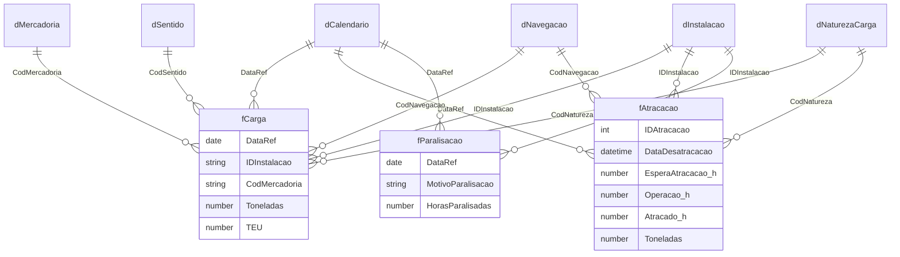

# Raio-X Portuário: desempenho dos portos brasileiros com foco no Nordeste

Quanto o Brasil movimenta, onde os navios esperam e como Suape se compara aos vizinhos — com dados abertos da ANTAQ, um pipeline que reproduz o total oficial e um painel Power BI público.


**Painel público:** LINK_PUBLICO · **Vídeo:** LINK_VIDEO · **Portfólio:** [gorc-supply.github.io](https://gorc-supply.github.io)

---

## O problema

O Estatístico Aquaviário da ANTAQ tem tudo — cada atracação, cada carga, cada paralisação desde 2010 — mas em arquivos de milhões de linhas, com regras de contagem que não estão na cara. Este projeto transforma essa base num painel que responde quatro perguntas:

1. **Quanto o Brasil movimenta** por porto, região, tipo de navegação e natureza da carga, e como isso evoluiu mês a mês e ano a ano?
2. **Como Suape se compara** com Pecém, Itaqui, Salvador, Aratu, Recife, Natal, Cabedelo e Maceió em volume, crescimento e eficiência?
3. **Onde estão os gargalos:** espera para atracar, tempo atracado x tempo de operação, prancha, sazonalidade e paralisações?
4. **O que cada porto movimenta:** principais mercadorias, embarque x desembarque, perfil de navegação?

## Principais achados

Todos os números vêm de [docs/valores_referencia.md](docs/valores_referencia.md) (seção 4), com a medida e o filtro de origem.

1. **Recorde nacional em 2025.** Os portos brasileiros movimentaram **1.403,8 milhões de t**, alta de **5,9%** sobre 2024. *Origem: [Toneladas] e [Var % Toneladas AA], Ano = 2025.*
2. **Suape trocou volume por valor.** A tonelagem ficou estável — **24,3 milhões de t** em 2025 (**-2,3%**), a **13ª** maior instalação do país, com **1,7%** do total —, mas os contêineres saíram de **519 mil TEU** em 2021 para **698 mil TEU** em 2025 (**34,6%** a mais), e a fatia de contêiner subiu de **26,7%** para **31,2%**. *Origem: [Toneladas], [Ranking Suape Brasil], [% do Total Brasil], [TEU], [% Contêiner]; Instalação = Suape.*
3. **Suape espera pouco para atracar, mas espera mais do que antes.** A espera mediana foi de **4,3 h** em 2025, **22,1 h** abaixo da média dos pares (**26,4 h**) — média puxada por Itaqui, com **143,9 h** de espera mediana. Em 2021 a espera mediana de Suape era **1,0 h**; em 2024 chegou a **5,9 h**. *Origem: [Espera Mediana (h)], [Espera Mediana Média Pares (h)], [Diferença Espera Suape vs Pares (h)].*
4. **O mix explica a espera de Suape.** Em 2025, navio de contêiner atracou com espera mediana de **0,8 h**; navio de granel líquido (derivados, petróleo, GLP), de **28,8 h**. Quem quiser melhorar a fila de Suape tem que olhar o cais de líquidos. *Origem: [Espera Mediana (h)], Instalação = Suape, Natureza = Contêiner / Granel Líquido e Gasoso.*
5. **Chuva é o maior ladrão de tempo.** No Brasil, chuva e clima respondem por **32,1%** das horas paralisadas em 2025; em Suape, por **37,9%**. A prancha operacional de Suape (**618 t/h**) fica abaixo da média nacional (**765 t/h**), que é puxada pelos terminais de minério. *Origem: [Horas Paralisadas] por motivo; [Prancha Média Operacional (t/h)].*

## Arquitetura



## Modelo de dados (esquema estrela)



Relacionamentos 1:N com filtro em direção única, sem muitos-para-muitos. Modo Import. A tabela `_Medidas` concentra as 51 medidas em pastas (Volume, Participação, Eficiência, Auxiliares).

## Dicionário de KPIs (resumo)

| Medida | O que é |
|---|---|
| [Toneladas] | Peso bruto movimentado (regra ANTAQ: `FlagMCOperacaoCarga = 1`, inclui transbordo) |
| [Var % Toneladas AA] | Variação contra o mesmo período do ano anterior (só meses com dado) |
| [Nº Atracações] | Atracações com movimentação de carga |
| [Espera Mediana (h)] | Mediana das horas entre chegada e atracação — o navio típico |
| [% Atracado em Operação] | Horas operando ÷ horas no berço |
| [Prancha Média Operacional (t/h)] | Toneladas ÷ horas de operação (razão de somas) |
| [Ranking Porto] | Posição por toneladas entre os portos visíveis |

Todas as medidas, com DAX, significado na operação e exemplo numérico: [docs/kpis.md](docs/kpis.md).

## Qualidade dos dados

- **Conciliação com a ANTAQ** ([docs/conciliacao_antaq.md](docs/conciliacao_antaq.md)): total anual do pipeline x total oficial publicado — diferença entre −0,13% e +1,16% de 2021 a 2025 (critério: ±2%, testado no pytest).
- **Regras de limpeza e linhas afetadas por ano** ([docs/data_quality.md](docs/data_quality.md)): tempos negativos descartados, outliers de tempo limitados ao P99,5 por natureza de carga (nunca a tonelagem), texto com acentuação corrompida corrigido.
- **Exploração da base** ([docs/exploracao.md](docs/exploracao.md)): colunas reais, chaves, nulos, definição de cada tempo conferida contra as datas.
- **Decisões** ([docs/DECISOES.md](docs/DECISOES.md)): o que foi decidido, as alternativas e o porquê.

> **Sobre a fonte.** O portal de download da ANTAQ (`web3.antaq.gov.br`) está fora do ar desde junho de 2026. Os arquivos oficiais foram obtidos de um espelho público (Hugging Face, CC-BY-4.0, revisão fixada) com o layout original; a fidelidade foi conferida contra os totais oficiais. Quando a ANTAQ voltar, o pipeline usa os zips oficiais automaticamente. Detalhes em [DECISOES.md, D02](docs/DECISOES.md).

## Como reproduzir

Pré-requisitos: Windows, Git, Python 3.12 (ou [uv](https://docs.astral.sh/uv/)) e Power BI Desktop.

```powershell
git clone https://github.com/gorc-supply/raio-x-portuario.git C:\projetos\raio-x-portuario
cd C:\projetos\raio-x-portuario
uv venv .venv --python 3.12          # ou: py -3.12 -m venv .venv
uv pip install --python .venv\Scripts\python.exe -r requirements.txt
.venv\Scripts\python etl\run_all.py  # baixa, trata, exporta, documenta, valida o PBIP e roda os testes
```

1. O `run_all.py` leva ~2 minutos e baixa ~90 MB em `data/raw/` (ignorado no Git). Os CSV finais ficam em `data/processed/`.
2. Se tiver os zips oficiais da ANTAQ (ex.: `2025Atracacao.zip`, `2025Carga.zip` ou `2025.zip`), coloque em `data/raw/antaq_oficial/` antes de rodar: eles têm prioridade sobre o espelho.
3. Abra `powerbi/RaioXPortuario.pbip` no Power BI Desktop. Se clonou em outra pasta, ajuste o parâmetro **CaminhoDados** (Transformar dados > Gerenciar parâmetros) e clique em Atualizar.
4. Confira os cartões contra [docs/valores_referencia.md](docs/valores_referencia.md).

Estrutura:

```text
etl/            01_download · 02_transform · 03_export · 04_documentar · explorar · kpis_doc
                gerar_pbip (gera o PBIP) · validar_pbip (schemas PBIR + referências) · run_all
data/processed/ CSV finais (fCarga, fAtracacao/ por ano, fParalisacao, dimensões, meta)
powerbi/        RaioXPortuario.pbip, .SemanticModel (TMDL), .Report (PBIR), tema-raio-x.json
docs/           decisões, pendências, exploração, qualidade, conciliação, KPIs, roteiro, post
tests/          pytest: chaves, órfãos, horas negativas, conciliação ±2%, PBIP, números do README
```

## Limitações

- **Último mês disponível: jan/2026.** O espelho foi gerado em abril/2026, antes de a ANTAQ tirar o portal do ar. 2026 aparece como ano parcial.
- **Fonte de contingência.** Os dados não foram baixados do site da ANTAQ, e sim de um espelho público dos mesmos arquivos. A conciliação com os totais oficiais reduz, mas não elimina, esse risco.
- **Mercadorias.** A tabela oficial de mercadorias da ANTAQ não estava disponível; as descrições vêm da nomenclatura SH oficial (Comex Stat). Códigos especiais da ANTAQ (0,3% da tonelagem) aparecem sem descrição.
- **Quebras por navegação e região** diferem um pouco mais que o total (ex.: interior +8% em 2021) por diferenças de classificação da ANTAQ; o total bate.
- **Espera mediana agregada é sensível ao mix de cargas** (ver achado 4). Compare portos com a mesma natureza de carga quando possível.
- O relatório PBIR foi gerado por código e validado contra os schemas oficiais, mas precisa ser aberto e revisado no Power BI Desktop antes de publicar ([docs/PUBLICAR.md](docs/PUBLICAR.md)).

## Autor e licença

**Gabriel Cunha** — Supply Chain & Operations, Recife/PE · [LinkedIn](https://www.linkedin.com/in/gabriel-cunha-xp) · [GitHub](https://github.com/gorc-supply) · [Portfólio](https://gorc-supply.github.io)

Código sob licença [MIT](LICENSE). Dados: ANTAQ (dados abertos), via espelho [vinicius-souza/antaq](https://huggingface.co/datasets/vinicius-souza/antaq) (CC-BY-4.0); nomenclatura SH: Comex Stat/MDIC.
